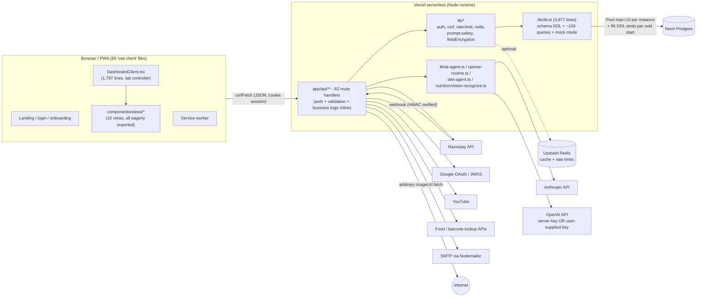

# Phase 0 Audit - Gym Bro monorepo

_Audited 2026-11-15 against `main` @ `23bcb04`. Read-only: no source files were changed._

## 0. Context (inferred - please correct)

The engagement template's context fields were left as placeholders, so these were inferred from the code:

| Field | Inferred value |
|---|---|
| Product | AI fitness app: AI workout routines + diet plans, workout tracking, nutrition logging (photo/barcode/search), body-composition and gym-equipment photo analysis, coach booking, communities/XP, premium analytics. Consumer users in India. |
| Stack | Next.js 16.1.1 (App Router) + React 19 + TypeScript + Tailwind 4, all API in Next route handlers. Postgres on Neon (`@neondatabase/serverless`), optional Upstash Redis, LangChain (Anthropic + OpenAI) + raw OpenAI SDK, Razorpay, Nodemailer. |
| Hosting | Vercel (serverless functions, `maxDuration = 60` on AI routes). |
| Scale | Unknown - **needed** to size Phases 4-5. |
| Sensitive data | **PII** (usernames/emails, names, phone numbers in coach bookings), **payments** (Razorpay subscriptions; no card data stored), **health/body data** (weight, measurements, body-fat estimates, **body photos**). |
| Hard constraints | From `CLAUDE.md`: legacy root `.py` files and `gym-ui/` must not be modified; light-only theme; CSP headers in `next.config.ts` must stay. |

### Conflicts between the engagement rules and this repo's `CLAUDE.md`

These need a decision from you before Phase 1. I won't pick one myself.

1. **Local verification.** RESOLVED: the "do not build/lint" rule was removed from `gym/CLAUDE.md` on 2026-11-15. The same line is still in `web-app/CLAUDE.md:11`; it should be removed too so the two files don't contradict each other.
2. **Branching.** Rule 1 says commit straight to `main`. Recent history (`Dev (#69-#71)`) shows a `dev` -> `main` PR flow, and CI also triggers on `dev`.
3. **Push after every commit.** That pushes to a branch Vercel auto-deploys from (assumed), so every commit becomes a production deploy.

## 1. Architecture map

**Request lifecycle (typical authenticated call):** `getSession()` (JWT HS256 cookie, 7d, stateless) -> `initializeDatabase()` (cold instance: 95 sequential DDL statements; warm: no-op) -> optional `requireCsrf` -> optional Zod parse -> query functions in `db.ts` -> `withCors(NextResponse.json(...))`.

There's no `middleware.ts`/`proxy.ts`, so auth, CSRF and rate limiting are opt-in per route, and coverage varies (see section 2).

**Repo hygiene:** Git root is `gym/`. The repo also tracks a root `node_modules/` (2,307 files), `.next/trace*`, `web-app/playwright-report/`, `web-app/test-results/`, `.claude/settings.local.json`, `.mcp.json` (despite `.gitignore`), the legacy `gym-ui/`, and about 20 MB of PNGs (two 2.4 MB screenshots sit inside `web-app/app/`, and `public/` has stray `*.png2`/`*.png3` files).

## 2. Tech debt & risk register

**P0** = fix before anything else / active risk of outage, money loss or data exposure. **P1** = fix in this engagement. **P2** = cleanup.

### P0

| # | Finding | Evidence | Why it matters |
|---|---|---|---|
| P0-1 | **Schema DDL runs on every cold start, in the request path.** 95 sequential `CREATE/ALTER` statements include `ALTER TABLE routines ALTER COLUMN archived SET NOT NULL`, `SET DEFAULT`, and `DO $$ ... ALTER COLUMN ... TYPE` blocks. | `lib/db.ts:128-578`, called at the top of nearly every route | `ALTER TABLE` takes `ACCESS EXCLUSIVE` locks. A burst of cold starts (deploy, traffic spike) queues every read and write on `profiles`/`routines` behind it, and `SET NOT NULL` takes that lock each time (the table scan itself is skipped once the column is already NOT NULL). Adds roughly 95 Neon round-trips to every cold request. There's no migration history and no rollback. |
| P0-2 | **Paid AI endpoints funded by the server key have no rate limit.** `body/analyze`, `gym/analyze` (vision, `detail: 'high'`, up to 6 images), and the `report` coach note. Registration is open, and `rateLimit` fails open when Redis is absent. | route matrix: `rl=0` on `body/analyze`, `gym/analyze`, `report`; `lib/rate-limit.ts:27-29` | Any signed-up user (or script) can run up unbounded OpenAI cost. |
| P0-3 | **There is no safety net.** No unit or integration tests. CI runs only `lint` + `tsc`, not build, tests or audit. The 6 Playwright specs (14 tests) aren't run in CI, have `webServer` commented out, and need a live DB. | `.github/workflows/ci.yml`, `playwright.config.ts`, `e2e/` | Any refactor is a blind change. This blocks Phases 2-5 by your own rules. |

### P1

| # | Finding | Evidence |
|---|---|---|
| P1-1 | **SSRF:** `gym/analyze` fetches any user-supplied `imageUrl` server-side, with no scheme, host or IP allow-list and no size cap (whole body buffered into memory). | `app/api/gym/analyze/route.ts:58-66` |
| P1-2 | **Open redirect after Google login:** `returnTo` is taken from the query string, stored in a cookie, and passed to `new URL(returnTo, origin)`, so an absolute URL redirects off-site. | `auth/google/start/route.ts:19`, `auth/google/callback/route.ts:36,83` |
| P1-3 | **Mock-auth backdoor if misconfigured:** with `ALLOW_MOCK_AUTH=true`, `authenticateUser` returns user 999 for *any* unknown user or **wrong password**, and DB failures fall back to mock data everywhere. It's guarded only by an env var, not `NODE_ENV`. | `lib/db.ts:122-126, 604-649` |
| P1-4 | **Body photos (sensitive) stored unencrypted** as base64 in `profiles.body_photos` JSONB. They come back from `SELECT *` on **every** `GET /api/profile` (fetched ~10x from the dashboard) and are kept in the Next data cache via `unstable_cache`. Field encryption covers only `username` and `name`. This becomes P0 if body photos count as health data under India's DPDP Act. Your call. | `lib/db.ts:252, 700-717, 873-921`; `app/api/profile/route.ts:18-27` |
| P1-5 | **Part of user-supplied API keys logged** (first 6 + last 4 chars). Users' OpenAI/Anthropic keys sit in `localStorage` and travel in request bodies, while the CSP allows `'unsafe-inline' 'unsafe-eval'`, so any XSS can steal them. | `app/api/routine/generate/route.ts:285-287`; `DashboardClient.tsx:74-77`; `next.config.ts:18` |
| P1-6 | **Vulnerable dependencies:** `npm audit` reports 48 (3 critical, 17 high). Direct ones: `next` 16.1.1 (critical, fixed in 16.4.6 - patch), `zod`, `undici`, `nodemailer` (fix is a major bump to 10.x). Most transitive highs come through `langchain`/`axios`/`form-data`. | `npm audit` run 2026-11-15 |
| P1-7 | **Payment webhook isn't idempotent or order-safe:** no event-id dedupe, and the last event processed wins. An out-of-order `subscription.charged`/`halted`/`cancelled` can regress status. `userId` comes from subscription `notes` (signature-verified, so not forgeable, but unvalidated against the DB). | `app/api/billing/webhook/route.ts:85-112`, `db.ts:2785` |
| P1-8 | **Real-looking personal contact details hardcoded** as fallbacks (phone number + Gmail address), and present in git history. | `lib/coach.ts:20-25` |
| P1-9 | **Rules-of-Hooks violations hidden by a demoted lint rule:** `react-hooks/rules-of-hooks` was downgraded to `warn` and has 23 hits (`AnalyticsView.tsx` 15, `WorkoutView.tsx` 8). Correction (verified later): not a crash today, because every hook sits after all early returns, so React treats the next full render as a fresh mount and resets local state. It relies on a React implementation detail; adding one hook above an early return would crash. | `eslint.config.mjs`, ESLint run |
| P1-10 | **Phantom dependency:** `openai` is imported directly but not declared in `package.json` (resolved only through `@langchain/openai`). A LangChain bump can break the build. | `app/api/body/analyze/route.ts:3`, `lib/nutrition/vision-recognize.ts:14` |
| P1-11 | **Inconsistent CSRF coverage** on state-changing routes (no `requireCsrf`): `billing/subscription/create`, `body/analyze`, `gym/analyze`, `coach/bookings/[id]` (PATCH/DELETE), `coach/me` (PATCH), `admin/coaches/[id]` + `admin/coach/bookings/[id]` (PATCH), `routines/reset` (DELETE), `user-location` (POST), `auth/logout`. `SameSite=Lax` on the session cookie limits real-world exposure, but the policy isn't enforced centrally. | route matrix |
| P1-12 | **Giant files carrying mixed concerns:** `lib/db.ts` (3,877 lines: DDL + every query for every domain + mock stores) and `DashboardClient.tsx` (1,797 lines, containing the logic `CLAUDE.md` says must not live there). Route handlers hold business rules (e.g. the booking cancellation window in `coach/bookings/[id]`). | file sizes |
| P1-13 | **Duplicated AI prompt pipelines** (`ai-agent.ts` vs `openai-routine.ts`), already listed as a known bug. | `CLAUDE.md` |

### P2

- **Stateless 7-day JWT with no revocation.** Logout only clears the cookie, and a stolen token stays valid for up to 7 days. An unused `sessions` table already exists (`db.ts:216`). No `iss`/`aud` claims; `userId` is cast without a type check.
- **CORS `Access-Control-Allow-Origin: *`** on every API response via two identical `withCors` helpers (`lib/corsMiddleware.ts`, `app/api/cors-middleware.ts`). Not exploitable for credentialed reads, but meaningless and duplicated.
- **Error-message leakage:** raw `error.message` is returned to clients in `auth/register`, `billing/subscription/create` and admin routes.
- **`/api/auth/google` POST returns the session JWT in the JSON body**, readable by JS.
- **Rate-limit key uses the first `X-Forwarded-For` entry.** Probably OK behind Vercel; should use the platform IP.
- **No server-side request-size or image-count validation** beyond array length; base64 size is unchecked (Vercel's 4.5 MB cap is the only limit).
- **`revalidateTag('user-profile')` is global:** any user's profile save evicts every user's cached profile. `undefined as any` casts at `db.ts:884,926,2214,3448`.
- **Unused or redundant deps:** `@vercel/postgres`, `undici`, `langchain` have no imports (`pg` had none at audit time; it now backs the `DATABASE_DRIVER=pg` local/test mode). There are two Postgres drivers. The root `package.json` declares `recharts`/`sonner` for no app.
- **Lint debt:** 206 warnings (121 `no-explicit-any`, 31 unused vars, 13 `set-state-in-effect`, 8 ``).
- **Mock-mode branches interleaved in every data function**, doubling the paths to test.
- **Toolchain drift:** CI uses Node 20, this machine runs Node 26, and `package.json` has no `engines` field. `vercel.json` uses `npm install` (not `npm ci`).
- **Tracked junk** (see section 1) bloats clones and leaks local tool config.

## 3. Build, test & dependency health

| Check | Result |
|---|---|
| `npm ci` | OK, 13.5 s |
| `tsc --noEmit` (`strict: true` already on) | OK, 0 errors, 7.5 s |
| `eslint .` | OK, 0 errors / 206 warnings (7 rules demoted from error to warn) |
| `next build` (Turbopack, Next 16.1.1) | OK, 19.5 s wall, 77 routes (15 pages, 62 API). Warnings: a Node 26 `module.register()` deprecation notice, and Next inferring the workspace root from the extra root `package-lock.json` |
| Unit / integration tests | NONE. None exist. No test runner installed. |
| E2E | 6 Playwright specs, 14 tests, need a live server + DB, not in CI, not run in this audit. |
| Coverage on critical paths | **0%** measured. |
| `npm audit` | 48 vulns: 3 critical, 17 high, 27 moderate, 1 low |
| Outdated | 32 packages. Notable majors: `nodemailer` 6->10, `typescript` 5->7, `eslint` 9->10, `framer-motion` 12->14, `lucide-react` 0.x->1.x, `undici` 6->8. Patch/minor: `next` 16.1.1->16.4.6, `react` 19.2.3->19.3.1, `zod`, `jose`, `@neondatabase/serverless`. |

### Bundle baseline (2026-11-15, `main` @ `23bcb04`)

Next 16 + Turbopack doesn't print route sizes. These figures are computed from each page's `client-reference-manifest` (`entryJSFiles`) plus the shared root chunks, measured raw and gzip -9. They form the Phase 4 "before" column.

| Route | First-load JS raw | gzip |
|---|---|---|
| shared by all pages | 511 KB | 156 KB |
| `/demo` | 1,060 KB | 310 KB |
| `/dashboard` | 1,036 KB | 303 KB |
| `/onboarding` | 707 KB | 218 KB |
| `/login` | 698 KB | 216 KB |
| `/` (landing) | 699 KB | 213 KB |
| `/coach/*`, `/admin/coach-*`, `/explore` | 679-689 KB | 209-212 KB |
| `/report` | 609 KB | 184 KB |
| `/privacy`, `/terms`, `/admin` | 563 KB | 171 KB |

- Total `static/chunks`: 3.0 MB across 33 files. `html2canvas-pro` + `jspdf` (largest chunks, 409 KB + 221 KB raw) are correctly lazy-loaded on `/report` only.
- `/dashboard` and `/demo` add about 525 KB raw / 147 KB gz over the shared base, because all 10 views are imported eagerly.
- Static pages like `/privacy` still ship 563 KB of JS (the shared base is heavy: framer-motion, providers).
- **Landing-page images:** `/` renders `public/app-dark.png` (1.3 MB) and `public/app-light.png` (1.5 MB) through plain ``, with no `next/image`, resizing or modern format. That alone very likely puts LCP over 2.5 s on mobile. `public/` also holds 7.4 MB of unused `*.png2`/`*.png3` copies.

## 4. Top 10 likely latency bottlenecks (evidence from code; not yet measured)

I have no production traffic access, so these are ranked by expected impact. Phase 4 will measure p50/p95/p99 before changing anything.

| # | Bottleneck | Evidence | Expected effect |
|---|---|---|---|
| 1 | **95 sequential DDL round-trips on every cold start**, plus lock waits | `db.ts:128-578` | Probably 0.5-2 s+ added to each cold request, and contention during deploys |
| 2 | **Dashboard fan-out and waterfall:** 8 API calls after hydration (`billing/status`, `profile`, `routines` -> then `completions` + `day-completions`, `diet`, `heatmap`, `streak`), each a separate function invocation doing its own JWT verify + init | `DashboardClient.tsx:101-387` | Several cold starts per page load; time to interactive data = slowest chain |
| 3 | **`GET /api/profile` returns `SELECT *`, including base64 gym/body photos** (potentially MBs), and is refetched ~10x in the dashboard flow | `db.ts:703`, `DashboardClient.tsx:234,656,1004,1179...` | Large JSON over the wire and through the parse/serialize cache layer |
| 4 | **AI generation runs synchronously in the request** (routine/diet up to 55-60 s). SSE "progress" is a timer, not real progress | `openai-routine.ts:367`, `routine/generate/route.ts:280` | Ties up function time; timeouts surface as user-visible failures |
| 5 | **Analytics computed on demand** from multiple aggregate queries (`exercise_completions JOIN routines` grouped) plus JS post-processing of `routine_json` blobs | `db.ts:1713-2020` | Grows linearly with history; no index on `exercise_completions(routine_id, completed_at)` for per-user range scans |
| 6 | **Heatmap, streak and analytics each re-scan the same completion data** independently | `db.ts:2433-2570`, `1713+` | 3x the work for one dashboard |
| 7 | **Global `revalidateTag('user-profile')`** makes the profile cache's hit rate collapse as concurrent users grow | `db.ts:884` etc. | More DB reads with more users |
| 8 | **`gym/analyze` downloads a remote image into memory and base64-encodes it** (15 s timeout); vision calls use `detail: 'high'` | `gym/analyze/route.ts:58-66` | Slow, memory-heavy, and costly |
| 9 | **All 10 dashboard views eagerly imported** into one client component, and **2.8 MB of unoptimized hero PNGs on the landing page** | `DashboardClient.tsx:7-16`; `app/page.tsx:225-231` | Measured: `/dashboard` first-load 303 KB gz (vs 156 KB shared base). Landing LCP is image-bound |
| 10 | **Login path:** pure-JS `bcryptjs` (cost 10, blocks the event loop) plus a second plaintext-username query on every miss (legacy migration fallback) | `db.ts:604-630` | Slower and more CPU-bound auth under load; doubles queries on failed logins |

Also note: `Pool({ max: 10 })` per instance x many concurrent Vercel instances. You need to confirm the pooled Neon URL is the one in use.

## 5. Proposed roadmap (adjusted to findings)

Tool choices follow rule 12 (boring, proven tools; new deps called out).

**Phase 1 - Safety net** (tag `phase-1-done`)
- Add **Vitest** (new dev dep, justified: there's no unit runner, and it works with TS/ESM with no config). Write characterization tests for pure logic: `setsReps`, `routine-postprocess`, `prompt-safety`, `fieldEncryption`, `csrf`, `validations`, `computeStreak`, analytics math.
- Route-level characterization tests against a **local Postgres in docker-compose**. Open question: `@neondatabase/serverless` speaks WebSockets, so locally we'd need the Neon WS proxy image or the already-installed `pg` driver behind a flag. I'll propose the option before doing it.
- Wire Playwright into CI with `webServer` + a seeded DB, covering login -> onboarding -> generate routine (AI stubbed) -> complete exercise -> diet -> billing status.
- Extend CI: `npm ci`, lint, `tsc`, unit tests, `next build`, e2e, `npm audit --audit-level=high` (report-only at first), pin Node via `engines` + `.nvmrc`.
- Add Prettier + a pre-commit hook (`lint-staged` + `simple-git-hooks`, both small deps). Re-promote `rules-of-hooks` to error only after P1-9 is fixed (Phase 2).
- Add `docker-compose.yml` (Postgres only, plus Redis optional), complete `.env.example`, `npm run dev:all`.
- Stop tracking junk (`node_modules/`, `.next/`, reports, local tool config, stray PNGs). **This deletes tracked files, so I'll ask first.**

**Phase 2 - Architecture**
- Split `db.ts` into `lib/db/{pool,users,profiles,routines,completions,nutrition,billing,coach,communities,xp}.ts` with a re-exporting barrel so call sites don't change.
- Introduce `lib/services/*` and move business rules out of route handlers.
- Add one `withApi()` route wrapper for session, CSRF, Zod, rate limit, error envelope and request id, replacing about 60 hand-rolled preambles.
- Zod-validated env config that fails fast at startup.
- Deduplicate the two routine generators.
- Split `DashboardClient.tsx` into hooks.
- Fix the hook-order bugs (P1-9).
- Isolate mock mode behind a single adapter.
- Shared contracts: export the Zod schemas as the single source of truth for request/response types (same repo, so no OpenAPI codegen needed at this scale).

**Phase 3 - Security**
- SSRF allow-list (or remove the `imageUrl` path).
- `returnTo` must be a same-origin relative path.
- Guard mock auth with `NODE_ENV !== 'production'`.
- Enforce CSRF on all state-changing routes via the wrapper.
- Rate limits on every paid AI endpoint, failing **closed** for paid routes when Redis is down.
- Stop logging key fragments; consider dropping user-supplied keys entirely.
- Body photos: move to private blob storage, encrypted at rest, excluded from profile responses.
- Webhook idempotency table.
- Session revocation (token version per user).
- Restrict CORS to known origins, generic error messages, request-size limits.
- Dependency upgrades: patch/minor first; `nodemailer` major **asks first**.

**Phase 4 - Performance (measure first)**
- Baseline: p50/p95/p99 for the 8 dashboard endpoints + login + profile, cold vs warm, plus `next build` bundle sizes and Lighthouse LCP/INP/CLS.
- Then:
  - move DDL out of the request path into a migration step (**ask first**)
  - one `/api/dashboard` bootstrap endpoint
  - slim the profile payload
  - per-user cache tags
  - indexes verified with `EXPLAIN ANALYZE`
  - `next/dynamic` for views
  - paginate list endpoints still missing it

**Phase 5 - Reliability**
- Versioned migrations: a plain SQL migration runner, no ORM. Backward-compatible migrations, take a backup first.
- Neon PITR plus a **tested** restore drill into a Neon branch.
- `/api/health` and `/api/health/deep`.
- Webhook/booking idempotency keys; timeouts + retry with backoff on all outbound calls; a circuit breaker for the LLM providers.
- k6 load test of the dashboard bootstrap and login; scaling plan for 10x / 100x.
- The app is already stateless except in-memory mock stores and `unstable_cache`.

**Phase 6 - Observability**
- Structured JSON logger with request IDs.
- Sentry (errors).
- `@vercel/otel` for traces.
- 3-5 SLOs and alerts.

**Phase 7 - Deploy / ops (right-sized)**
- This is a Vercel app, so multi-stage Dockerfiles and IaC for compute would be over-engineering at this scale (rule 13). Docker stays for local dev and CI only.
- Use Vercel Preview as staging with a Neon branch DB per environment.
- Instant rollback via Vercel's previous deployments.
- Env-var feature flags for risky changes.
- Secrets runbook and a cost estimate (dominated by LLM spend).

**Phase 8 - Docs**
- README (10-minute setup), ARCHITECTURE.md (built from this file), ADRs for the decisions above, API reference generated from the Zod schemas, incident runbooks, CONTRIBUTING.md.

## 6. Questions for you before Phase 1

1. Resolve the three rule conflicts in section 0.
2. Expected scale (users now / in 12 months) and whether body photos should be treated as health data.
3. Is the server's `OPENAI_API_KEY` meant to fund vision features for all users, or should those be premium-gated?
4. Are you OK with removing tracked `node_modules/`, `.next/`, reports and stray PNGs from git (history preserved, files deleted going forward)?
5. Are `coach.ts`'s fallback phone/email a real person's? If so, they should be removed, and the person may want to know they're in public history (if the repo is public).

## 7. Remediation status (updated 2026-11-15, Phase 3 closed: `phase-3-done`)

An independent mutation review of Phase 0/1 (39 deliberate breakages) checked 16 claims in this document; the inaccuracies it found and the P1-9 overstatement are corrected in place above. Every fix below shipped with a test that failed on the previous code (or, for refactors, characterization tests that pass before and after).

| Finding | Status | Commit |
|---|---|---|
| P0-1 DDL on every cold start | Fixed: hash-versioned schema, applied once per change in one transaction under an advisory lock; cold start = 1 SELECT (local: 95 round-trips p50 44.3 ms -> 1 round-trip p50 0.4 ms) | `dc12055` |
| P0-2 Unlimited paid AI calls | Fixed: per-user minute/hour limits, fail closed in production | `a2927b7` |
| P0-3 No safety net | Fixed: 133 unit, 85 integration, 18 e2e tests; CI runs lint, typecheck, unit, build, integration and Playwright on Node 24 | Phase 1 + later |
| P1-1 SSRF in gym/analyze | Fixed: client-supplied URL fetch removed | `4f89bbd` |
| P1-2 Open redirect after Google login | Fixed: same-site return paths only | `d721cbc` |
| P1-3 Mock auth in production | Fixed: hard-disabled when NODE_ENV=production | `c48cbf3` |
| P1-4 Body photos unencrypted, sent with every profile | Fixed: AES-256-GCM at rest (DB_ENCRYPTION_KEY is set in production), legacy rows re-encrypted on read, served only by GET /api/body/photos | `63bf292` |
| P1-5 API key fragments in logs | Fixed | `5ceb392` |
| P1-6 Vulnerable dependencies | Fixed: next 16.4.3, nodemailer 10.2.1, non-breaking audit fixes; npm audit 48 -> 12 (0 critical, 1 high: langsmith, in an unused feature; deferred to the LangChain family upgrade) | `2a6afd2`, `187d421`, `ac19dd2` |
| P1-7 Webhook not idempotent / order-safe | Fixed: event-id dedupe + last_event_at ordering | `949ec17` |
| P1-8 Hardcoded coach phone/email | Fixed (values remain in git history) | `9f73805` |
| P1-9 Rules-of-Hooks violations | Fixed; rule is an error again | `e65507c` |
| P1-10 Undeclared openai/langsmith | Fixed; lint blocks undeclared imports | `8e7de1b` |
| P1-11 CSRF gaps | Fixed on all 10 handlers, client calls use csrfFetch | `e218eaf` |
| P1-12 / P1-13 Giant files, duplicate AI prompt code | Fixed (Phase 2): db.ts split into 13 modules; DashboardClient 1,799 -> 1,402 lines via tested hooks; identical prompt sections shared, both prompts snapshot-tested (the two providers' instruction texts intentionally differ) | `8ecec92`, `6d630e5`, `717a6e0`..`eeb4a46` |
| P2 Raw error messages to clients | Fixed: UserFacingError / generic 500; AI provider errors mapped; diet route surfaces provider errors | `4905872`, `25ed476`, `d7aa900` |
| P2 Stateless sessions, no revocation | Fixed: users.session_version checked per request, bumped on logout (local p50 0.38 ms per check) | `aea58a0` |
| P2 CORS `*` on every response | Fixed: removed (same-origin app and TWA) | `5337578` |
| P2 Token-in-body Google endpoint | Fixed: unused endpoint removed | `c3c8d60` |
| P2 Tracked junk in git | Fixed: 2,325 files untracked | cleanup commit |
| P2 `pg` loaded on every production cold start | Fixed: loaded only with DATABASE_DRIVER=pg (saves ~17.6 ms median per cold start) | `6a74076` |
| P2 CSRF "expired" message unreachable | Fixed | `85cc410` |
| P2 Pre-commit skipped delete-only commits; CI on Node 20 | Fixed: hook covers deletions; CI on Node 24 via .nvmrc, Playwright in CI | `f8fd827`, `36db070`, `929b788`, `0a0a814` |

Still open (P2, scheduled for later phases):
- Onboarding "Skip for now" routes to /dashboard, which sends a profile-less user straight back to /onboarding, so new users cannot skip. UX.
- Inactive bottom-nav tabs are icon-only buttons without accessible names. Accessibility.
- TIMESTAMP (without time zone) columns are only read correctly when Node and Postgres share a time zone (true on Vercel, UTC).
- eslint-config-next 16.4.x adds React-compiler lint rules that report new errors; adopt deliberately in Phase 2.
- LangChain family upgrade (clears the last high advisory, langsmith).
- 179 lint warnings (no errors).

## 8. Phase 2 (architecture) status, closed at `phase-2-done`

Done (behaviour-preserving, each proven):
- `lib/db.ts` (3,563 lines) split into `lib/db/*` per domain; 144 declarations verified verbatim, public API identical (`8ecec92`).
- Routine prompts: the identical sections shared in `lib/routine-prompt-sections.ts`; both providers' full prompts snapshot-tested (`6d630e5`).
- `DashboardClient.tsx` 1,799 -> 1,402 lines: `useAiSettings`, `usePremiumStatus`, `useGymPhotos`, `useBodyPhotos`, `useWorkoutProgress(+Actions)`, each preceded by new e2e characterization tests; dead code removed.
- Static invariant test: every state-changing API handler must call `getSession()` and `requireCsrf()` (explicit allowlist with reasons) (`ceaec27`).
- Startup configuration validation (`lib/env.ts`, `instrumentation.ts`) (`9b74f29`).

Deliberately deferred (owner decision 2026-11-15, moving to Phase 4):
- Service layer: move business rules (coach booking rules, routine generation orchestration) out of route handlers; best done route by route with feature work.
- One shared route wrapper for ~60 routes (boilerplate; the security part is already enforced by the invariant test).
- Further `DashboardClient` splitting (remaining code is the orchestration layer: routine history, diet, profile form, generation).
- Adopting eslint-config-next 16.4 React-compiler rules; 172 lint warnings (0 errors).
- Unifying the two providers' routine instruction texts (a product decision).

