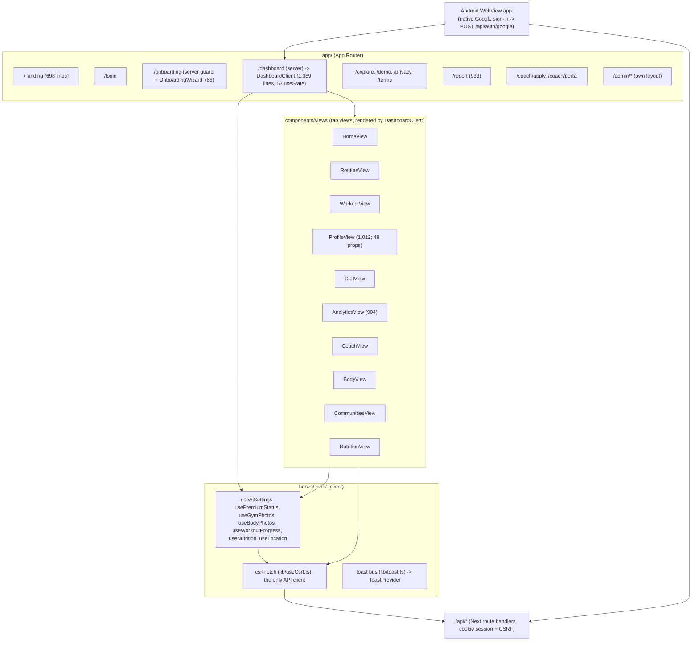

# Frontend Audit (Phase 0)

Date: 2026-11-16. Scope: `web-app/` UI (pages, components, hooks, client libs). Backend (`app/api/**`, `lib/db/**`) is out of scope except where the UI depends on it.

Method: findings come from reading the code itself (not its comments) and from local measurements on a production build (`next build` + `next start` + local Postgres). Nothing was run against production for this audit. Every number below says how it was measured.

## 0. Context (assumptions to confirm)

The engagement prompt's context fields were left as placeholders. Assumed from the code:

| Field | Assumption |
|---|---|
| Product | Gym Bro: AI workout routines and Indian diet plans, workout tracking, nutrition logging, coach booking, premium analytics |
| Users / devices | Indian gym-goers, mostly phones: mobile web plus an Android app that wraps the site in a WebView |
| Frontend | `web-app/`: Next.js 16 App Router, React 19, TypeScript (strict), Tailwind 4, framer-motion, lucide-react |
| Sensitive data in UI | PII (email/username), health (weight, measurements, body photos, body-composition analysis), payments (Razorpay checkout), the user's own AI API key |
| Brand | Keep the logo and the teal primary; everything else may change |
| Hard constraints | The Android app's WebView must keep working; API contracts must not change (backend frozen) |

**Decision needed (conflict):** the engagement requires light and dark mode. The app is deliberately light-only today ("Liquid Light"): no `.dark` class is ever applied, the theme toggle was removed, and 150 `dark:` utilities sit dormant. Adding dark mode is a product decision, not a fix.

## 1. Architecture map

- Routing: App Router, 14 pages. The dashboard is a single client page whose "routes" are tab state (`activeView`) plus `history.pushState`, not URLs. Deep links to a tab don't exist.
- State: React `useState` only; no global store. `DashboardClient` owns 53 pieces of state and passes them down (ProfileView receives 49 props).
- Data fetching: 68 `csrfFetch`/`fetch` call sites inside components and hooks, each with its own loading/error handling. No caching library: switching tabs refetches.
- Auth: httpOnly session cookie + double-submit CSRF token (`lib/useCsrf.ts`). Server pages check the session (`/onboarding`, `/dashboard`).
- Error handling: no `error.tsx`, `global-error.tsx`, `not-found.tsx` or `loading.tsx` anywhere. A render crash shows Next's default error screen.

## 2. Screens and their components

| Route / tab | Main components |
|---|---|
| `/` | page.tsx (self-contained: hero, features, pricing, FAQ), BrandLogo, CookieConsent |
| `/login` | page.tsx, LoginAnimation, BrandLogo |
| `/onboarding` | OnboardingWizard (GlassCard, Chip, AnimatedButton) |
| dashboard Home | HomeView, StreakBanner, HeatMap, PersonalRecordsCard, TabQuote, BottomNav, Sidebar |
| Routine / Workout | RoutineView, WorkoutView, ExerciseCard, SwipeableExercise, RestTimer, MuscleMapModal, YouTubeHoverPreview |
| Profile | ProfileView (1,012 lines), ImageUploadCard, EquipmentSummary, GymNearbySheet |
| Diet / Nutrition | DietView, DietDisplay, NutritionView + 11 components/nutrition/* (GoalSetupModal, BarcodeScannerModal, PhotoLogModal, FoodSearchPanel, SheetModal, ...) |
| Body | BodyView, BodyCompositionSummary, ImageUploadCard |
| Coach / Community / Analytics | CoachView (577), CommunitiesView (481), AnalyticsView (904) |
| `/report`, `/coach/*`, `/admin/*`, `/explore`, `/demo` | page-level components, mostly self-contained |

## 3. Code health

| Finding | Evidence |
|---|---|
| Giant components | DashboardClient 1,389 lines; ProfileView 1,012; report 933; AnalyticsView 904; OnboardingWizard 766; landing 698; 20 UI files over 300 lines |
| Prop drilling | ProfileView takes 49 props from DashboardClient; DashboardClient has 53 `useState` |
| Business logic in UI | Week/date calculations, routine regeneration rules and completion bookkeeping live in DashboardClient (e.g. `mondayOfThisWeekLocal`, week rollover in `performGeneration`) |
| Ad-hoc fetching | 68 fetch call sites in components/hooks, no shared loading/error/caching |
| Hydration mismatch (bug) | React error #418 on every dashboard load (console, local prod build). Causes: `lib/quotes.ts:148` picks the quote from a shuffled list with a per-process counter (server and browser pick different quotes); `components/views/HomeView.tsx:82` computes "Good morning/afternoon" from the clock during render (production server runs UTC, users IST, so they disagree part of every day) |
| `any` / disabled lint | 14 explicit `any`, 16 `eslint-disable` in UI; 170 lint warnings repo-wide |
| Console noise | 17 `console.*` calls in UI components |
| Missing error boundaries | no `error.tsx` / `global-error.tsx` / `not-found.tsx` |
| Dead code / deps | `@vercel/postgres` and `undici` are imported nowhere; the "OPENAI_PROXY" support mentioned in an error message (`lib/openai-routine.ts:259`) is not implemented |

## 4. Design inconsistencies

Counted with grep over `app/` and `components/` (`.tsx` + `.css`):

| Measure | Count |
|---|---|
| Distinct hex colors | 90 (124 hex occurrences in `.tsx`) |
| Distinct `rgb()/rgba()` values | 221 |
| Inline `style={{...}}` | 107 |
| Arbitrary Tailwind values `x-[...]` | 217 |
| Text size classes | 20 distinct, incl. 8 one-off pixel sizes (10, 11, 13, 14, 15, 16, 18, 22 px) |
| Shadow classes | 32 distinct |
| Radius classes | 9 distinct |
| Buttons | 136 raw `<button>` plus `AnimatedButton` (50 uses); no shared Button with variants |
| Inputs | 59 raw `<input>`, no shared Input/FormField |
| Modal-like components | 11 (modals, sheets, ConfirmModal, toast "dialog"), no shared Dialog primitive |
| CSS tokens | 76 custom properties in a 1,035-line `globals.css`, plus a `.lg-remap` layer that rewrites dark-authored classes to light ones |

Visual review (local screenshots at 375 px):

- Landing: header is cramped (wordmark runs into "Sign in"); the phone mockup is pushed off-screen.
- Dashboard (every tab): a quote banner takes the top of the screen; the menu button floats over it; the "0 XP" pill floats over content; the bottom bar covers the end of the page (the last card is cut off).
- Workout: exercise names are mint text on mint glass (low contrast); three competing ways to complete an exercise (checkbox, swipe, Log row) with no clear primary action.
- Overall: teal on pale teal everywhere, glass surfaces lowering contrast further, weak hierarchy between primary and secondary actions.
- Dark mode: not supported (see section 0).

## 5. Responsive behaviour

Sweep at 320 / 375 / 768 / 1440 px over 17 screens (local, Playwright):

| Finding | Evidence |
|---|---|
| Landing scrolls sideways on phones and tablets | 44 px too wide at 320, 58 at 375, 96 at 768. Cause: hero image wrapper `scale-[1.5]` at all sizes (`app/page.tsx:215`, image edge at 433 px on a 375 px screen); a feature card row also overflows 16 px |
| Small tap targets | elements under 44x44 px at 375 px: Profile 59, Workout 16, Routine 13, Coach 13, Onboarding 11, Nutrition 11, Body 9, Home 7, Landing 7 |
| All other screens | no horizontal overflow at any width |

## 6. Accessibility

| Finding | Evidence |
|---|---|
| Zoom disabled on every page (WCAG 1.4.4) | `app/layout.tsx:35-36` `maximumScale: 1, userScalable: false`; Lighthouse `meta-viewport` fails on all pages |
| No visible keyboard focus | 0 `focus-visible` styles in components, 1 in CSS; 35 `outline-none` |
| Labels not linked to inputs | 58 `<label>` elements, 1 `htmlFor` |
| No landmarks | 0 `<main>`, 0 `<header>`; 2 `<nav>` |
| Unnamed dashboard menu button | Lighthouse `button-name`: the fixed hamburger button (icon only) |
| Low contrast | Lighthouse `color-contrast` on landing (gray-500 footer links); visual review: mint-on-mint text in workout cards |
| Reduced motion | 5 places handle `prefers-reduced-motion`; framer-motion animations elsewhere ignore it |
| Already fixed this week | bottom-nav names and `aria-current` (`372f96e`), toasts announced via `role=alert/status` (`a6d2cea`) |

Lighthouse accessibility (local, mobile): landing 90, login 95, dashboard 88.

## 7. Missing UX states

- No route-level error or not-found pages; no offline state.
- Loading: skeletons exist (`SkeletonLoader`) but are used unevenly; several views show nothing while loading.
- Errors: a single toast for everything (since `5e33b4b`); no inline errors next to the failing section and no retry buttons.
- Forms: validation only on save, message text not tied to the field (labels not linked).
- Empty states: present for routine ("No Routine Yet") and some lists; others are blank.

## 8. Performance baseline (local production build)

Lighthouse 13.6.0, simulated throttling, `127.0.0.1` (no CDN or real network; production LCP will be worse):

| Page | Perf | A11y | Best pr. | SEO | LCP | CLS | TBT | JS (transfer) |
|---|---|---|---|---|---|---|---|---|
| landing, mobile | 86 | 90 | 96 | 100 | 4.21 s | 0.000 | 47 ms | 202 KB |
| landing, desktop | 100 | 90 | 96 | 100 | 0.82 s | 0.000 | 0 ms | 202 KB |
| login, mobile | 100 | 95 | 100 | 100 | 1.06 s | 0.000 | 31 ms | 195 KB |
| login, desktop | 100 | 95 | 100 | 100 | 0.29 s | 0.008 | 0 ms | 195 KB |
| dashboard, mobile | 84 | 88 | 96 | 100 | 4.22 s | 0.085 | 38 ms | 237 KB |
| dashboard, desktop | 99 | 88 | 96 | 100 | 0.87 s | 0.032 | 0 ms | 237 KB |

- Mobile LCP 4.2 s on landing and dashboard (target 2.5 s).
- Dashboard CLS 0.085 on mobile (under 0.1 but close).
- `logo.png` is 153x176 shown squashed into 32x32 and 24x24 squares (Lighthouse `image-aspect-ratio`).
- Request pattern: 12 API calls on dashboard load in two waves (measured in Phase 4 of the backend engagement); no client cache, so tab switches refetch.
- Already done: hero image WebP (`83c4304`), nine non-Home views code-split (`f6cbf04`, 934 -> 735 KB uncompressed JS).

## 9. Security (frontend)

| Finding | Evidence |
|---|---|
| User's own AI API key in localStorage | `hooks/useAiSettings.ts` reads/writes `gymbro_ai_settings` (`apiKey`); any injected script can read it |
| CSP allows `unsafe-inline` and `unsafe-eval` scripts | `next.config.ts` `script-src` (weakens XSS protection; needed today by inline scripts/Razorpay, to be confirmed) |
| `dangerouslySetInnerHTML` | none |
| External links | all 3 `target="_blank"` links have `rel="noopener noreferrer"` |
| Secrets in bundle | no `NEXT_PUBLIC_*` variables referenced; AI keys stay server-side except the user's own key above |
| Session | httpOnly cookie (good); CSRF token in a readable cookie by design (double-submit) |

## 10. Dependency health

- `npm audit --omit=dev`: 0 vulnerabilities (after `715006c`); 7 moderate in dev-only tooling (`minimatch` chain).
- Unused: `@vercel/postgres`, `undici`.
- Major versions behind (9): `framer-motion` 12 -> 14, `lucide-react` 0.562 -> 1.x, `openai` 6 -> 7, `typescript` 5.9 -> 7, `eslint` 9 -> 10, `vitest` 4 -> 5, `@types/node` 20 -> 26, `jsdom`, `undici`. Each needs approval (rule 9).
- No accessible primitive library (Radix/Headless UI), no form library, no data-fetching cache, no class-merging helper (`clsx`/`tailwind-merge`/`cva`).

## 11. Proposed roadmap (adjusted)

Already in place from the backend engagement: strict TypeScript, ESLint, pre-commit hook, CI (lint, typecheck, unit, integration, Playwright, dependency audit), 33 Playwright tests, startup env validation.

| Phase | Work |
|---|---|
| 1 Safety net | Visual baselines (375/768/1440) for 17 screens committed to the repo; axe checks in Playwright; bundle-size budget in CI (the dashboard budget test exists, extend per route); Prettier; `eslint-plugin-jsx-a11y` rules |
| 2 Architecture | Fix the hydration mismatch first (P1); `error.tsx`/`global-error.tsx`/`not-found.tsx`; split DashboardClient and ProfileView (feature folders); typed API layer over `csrfFetch`; TanStack Query for server state (new dependency, justify); one form approach |
| 3 Design system | Step A: `DESIGN.md` proposal with before/after of Home, Workout and Landing, **light only or light+dark per your decision**; then tokens, primitives (Radix-based Button, Input, FormField, Dialog, Sheet, Tabs, Toast), `/design` style guide; then migrate screen by screen |
| 4 Accessibility | Re-enable zoom; focus-visible rings; label/`htmlFor`; landmarks; 44 px targets; contrast in every theme; reduced motion; axe in CI |
| 5 Performance | Mobile LCP 4.2 s -> < 2.5 s (landing hero, fonts, dashboard first paint); route budgets; query caching; image fixes (logo) |
| 6 Security | Move the user's AI key out of localStorage (needs a backend change: report only); tighten CSP (remove `unsafe-eval` if possible) |
| 7 Observability | Sentry (pending your DSN), Web Vitals reporting, privacy-respecting analytics |
| 8 Docs | README, DESIGN.md, FRONTEND_ARCHITECTURE.md with ADRs, CONTRIBUTING.md |

Priority items:

- **P1:** hydration mismatch on every dashboard load; landing scrolls sideways on phones; zoom disabled; no error/404 pages; no visible keyboard focus.
- **P2:** low contrast and weak hierarchy; small tap targets; unlinked labels; quote banner and floating elements covering content; AI key in localStorage; `unsafe-eval` in CSP.
- **P3:** design-value sprawl (90 hex, 221 rgba, 32 shadows); giant components; ad-hoc fetching; unused dependencies; squashed logo.
